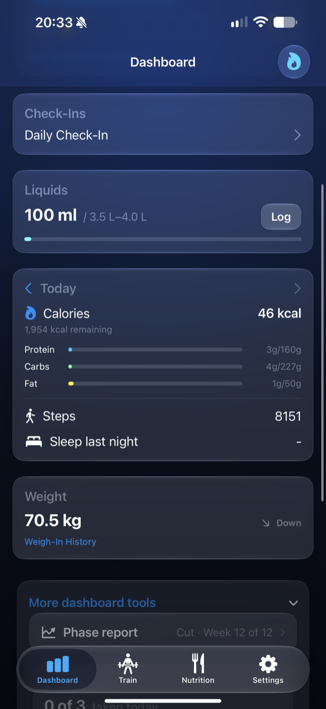
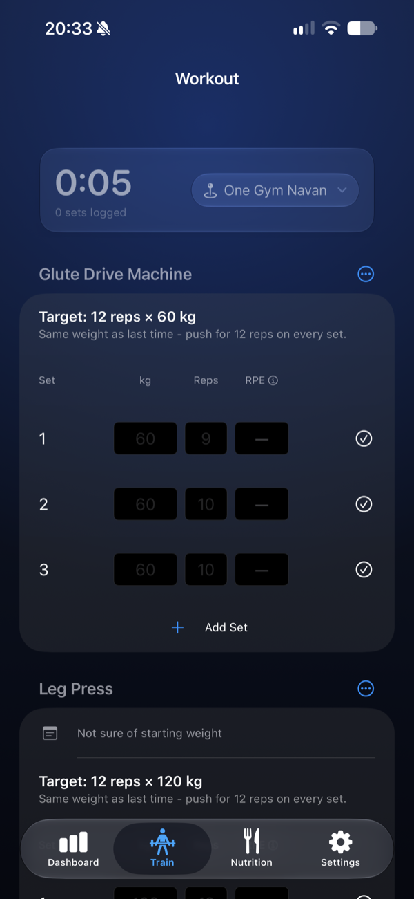
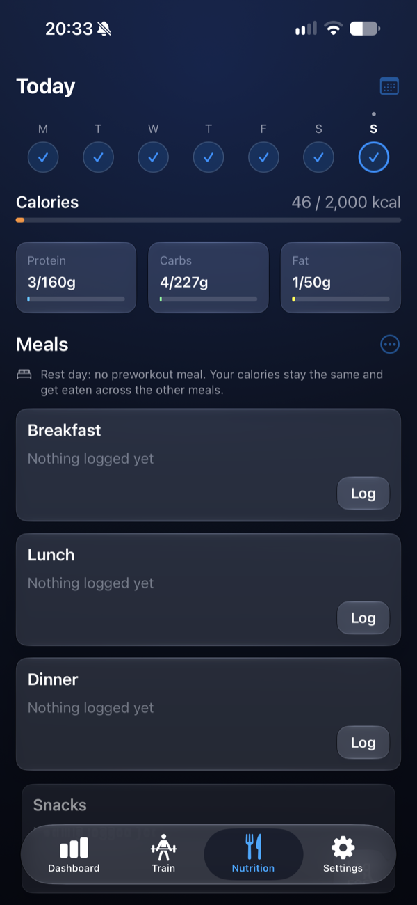
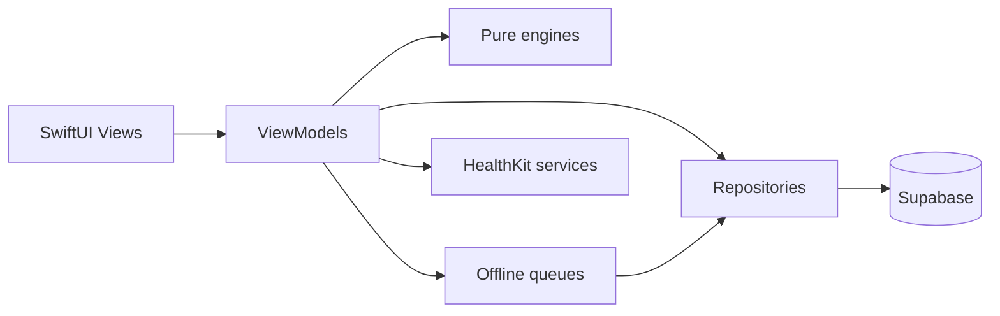

# 1% Fitness

A native iOS app that tracks training, nutrition, sleep and body data, and uses it to adjust calorie targets and keep you on plan.

## Screenshots

| Dashboard | Workout logging | Nutrition |
|---|---|---|
|  |  |  |

## Features

- **Phases.** Cut, maintain or bulk, each with calorie, protein and step targets, a target weekly weight change and required training sessions.
- **Check-ins.** A daily check-in (weight, waist, energy, soreness, yesterday's water and whether it was off plan) and a weekly check-in flow.
- **Workout logging that works offline.** Routines, sets, supersets, running plans and Live Activities. Writes are saved on the device first and synced later.
- **Nutrition logging.** Food search (including Open Food Facts), barcode and label scanning, recipes, and a Bluetooth kitchen scale.
- **Adherence score.** A daily and weekly 0 to 100 score against the phase targets, plus a coach that learns your weak days and a streak and star system.
- **Adaptive TDEE.** Estimates maintenance calories from logged intake and the weight trend, and recommends a new target.
- **Weight trend.** Smooths scale weight with an exponentially weighted moving average.
- **HealthKit and Apple Watch.** Syncs steps, sleep, heart rate, body mass, energy and workouts; a watchOS companion handles run sessions. Progress photos are stored in a private bucket.

## Tech stack

- Swift 5 language mode and SwiftUI, targeting iOS 26 (Xcode 26), with Swift Charts, SwiftData, ActivityKit and WidgetKit
- HealthKit, CoreBluetooth, CoreNFC and WatchConnectivity
- Supabase (Postgres, Auth, Storage) through `supabase-swift`, the only third-party package
- Swift Testing, 128 tests across 21 suites
- Node scripts for migrations and test data

## Architecture

Views read state from view models. View models call repositories and pure calculation engines. Repositories are the only code that talks to Supabase, and the offline queues sit between the view models and the repositories for the writes that must survive a lost connection.



No view touches the Supabase client directly. The engines (adherence, TDEE, trend weight, coach, streaks, phase report) take plain values and return plain values, with no network or HealthKit calls inside, so they are unit tested directly.

## Design decisions

### Adherence score
Each day gets up to four component scores: calories (35%), protein (25%), training (25%) and steps (15%). Calories are scored on both sides of the target, because under-eating on a cut is a miss too. Protein and steps only lose points for a shortfall. A component with no data is left out and the remaining weights are renormalised, and a day only gets an overall score if at least 2 of the 4 components were scored, so a day with only steps logged cannot pass for a fully tracked one. A planned rest day scores no training component at all instead of counting as a miss. The weekly training score is sessions completed against the phase's required sessions, so a run of days without a check-in cannot quietly count as "not applicable".

### Trend weight (EWMA)
Scale weight moves by a kilo or more from water and food alone, so a raw reading says little about whether the plan works. The trend is an exponentially weighted moving average with a base smoothing factor of 0.1, applied only on days with a weigh-in. The factor is widened for gaps between weigh-ins, so a week away from the scale does not mute the next reading. Same-day weigh-ins are averaged first. The chart shows both lines, and the TDEE engine uses the trend.

### Adaptive TDEE
Over a trailing 21-day window the engine takes the average logged intake and the trend weight change, converts the change to calories at 7,700 kcal per kg, and subtracts it from intake to estimate maintenance. The recommended target is that estimate plus the phase's weekly change goal, moved by at most 150 kcal per step so one noisy window cannot swing the target. It declines to answer with fewer than 8 weigh-ins or patchy logging. Days marked sick or not tracked, and the water-weight bump after an off-plan day, are excluded, and if more than a quarter of the window is excluded there is no recommendation.

### Offline workout queue
Gyms often have no signal, so a set must never wait on the network. Every change is written to a local SwiftData store first and then synced in the background after each write, when the network returns, and every 20 seconds as a fallback. Rows get a client-generated UUID that is reused as the Supabase primary key, so replaying a sync after a crash is a plain upsert and cannot create duplicates. A flush writes the workout before its sets because of the foreign key, and deletes are kept as tombstones until the server confirms them. There is no merge logic: the last write wins, which assumes one device is logging at a time. Each queued row stores its owner, so one account's data is never sent under another's session.

### Owner-scoped RLS and repositories
All 50 tables have row level security. User-data tables are owner-only for reads and writes (`user_id = auth.uid()`). The shared exercise and food catalogs are readable by signed-in users, who can add or change only their own custom rows. Storage buckets are private, with object paths that start with the user's id, so a leaked anon key reaches none of a user's data without their session. The app never holds a service-role key. On the client, each area of the data has a repository, and views and view models go through those, which keeps queries and the user id in one place and lets the offline queues reuse the same write paths.

## Getting started

Requires Xcode 26, Node.js, and a free Supabase project.

1. Clone the repo.
   ```bash
   git clone https://github.com/liamdkn/fitness_application.git
   cd fitness_application
   ```
2. Create a project at [supabase.com](https://supabase.com). From its settings, copy the project URL, the anon (publishable) key and the database connection string.
3. Run the migrations in order. They are applied once each and recorded in a `schema_migrations` table.
   ```bash
   echo 'DATABASE_URL=<your connection string>' > supabase/.env
   cd scripts && npm install && node migrate.js up
   ```
4. Copy the config template and fill in your URL and key. Keep the `https:/$()/` form of the URL, because `//` starts a comment in `.xcconfig` files.
   ```bash
   cp ios/FitnessTracker/Config.xcconfig.example ios/FitnessTracker/Config.xcconfig
   ```
5. Open `ios/FitnessTracker/FitnessTracker.xcodeproj`. For the app, watch and widget targets, select your own team under Signing & Capabilities. Change the `dkn.FitnessTracker` bundle identifiers and the `group.dkn.FitnessTracker` app group, which is set in both entitlements files and in `Shared/WidgetSnapshot.swift`, to ones your team owns. Keep the HealthKit capability enabled.
6. Run on a simulator or device. HealthKit data, Bluetooth and NFC need a real device.
7. The app has no sign-up screen, so create a user under Authentication in the Supabase dashboard first. `node scripts/seed-test-data.js` fills a `test@test.com` account with sample history. It resets that account's data, so use it only on a development project.

Run the tests with any installed simulator in place of `iPhone 17e`:

```bash
xcodebuild test -scheme FitnessTracker -only-testing:FitnessTrackerTests \
  -destination 'platform=iOS Simulator,name=iPhone 17e'
```

## Project structure

```
ios/FitnessTracker/
  FitnessTracker/         App: Models, Services (repositories, engines, offline queues), ViewModels, Views
  FitnessTrackerWatch/    watchOS companion
  FitnessTrackerWidgets/  Widgets and Live Activities
  FitnessTrackerTests/    Swift Testing unit tests
supabase/migrations/      Ordered SQL migrations: schema, RLS, storage
scripts/                  Migration runner, test-data seeder, Bluetooth scale probe
docs/plans/               Design specs
```

## License

MIT, see [LICENSE](LICENSE).
